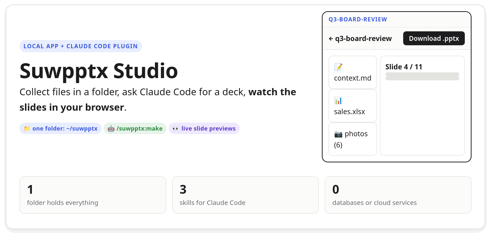
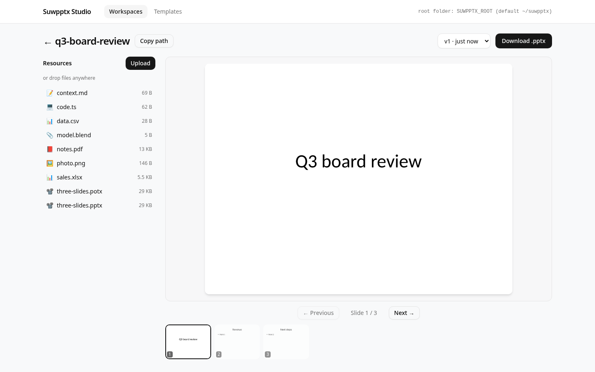
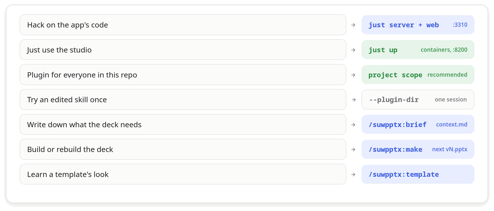

# Suwpptx Studio

<picture>
  <source media="(prefers-color-scheme: dark)" srcset="docs/visual/board/img/readme/hero-dark.png">
  
</picture>

Build PowerPoint decks with Claude Code from a folder of photos, data, notes and old decks, and see every
version in your browser. Everything is plain files in `~/suwpptx` (or `SUWPPTX_ROOT`).

<picture>
  <source media="(prefers-color-scheme: dark)" srcset="docs/visual/board/img/readme/app-dark.png">
  
</picture>

## How it works

<picture>
  <source media="(prefers-color-scheme: dark)" srcset="docs/visual/board/img/readme/flow-dark.png">
  
</picture>

There is no database and no API for the agent: Claude Code reads and writes the folder with its own tools, and
the app watches the same folder.

## Get started

<picture>
  <source media="(prefers-color-scheme: dark)" srcset="docs/visual/board/img/readme/start-dark.png">
  
</picture>

**1. Tools** (once per machine; details and other systems in [docs/development.md](docs/development.md)):

```sh
sudo dnf install libreoffice-impress poppler-utils   # slide previews (Ubuntu: libreoffice-impress-nogui poppler-utils)
python3 -m pip install --user python-pptx            # Claude builds the decks with it
corepack enable && just sync                         # pnpm, the .NET tools, packages and git hooks
```

You also need the .NET 10 SDK, Node 24, [`just`](https://github.com/casey/just) and
[Claude Code](https://code.claude.com/docs/en/setup).

**2. Run the app**, in two terminals, then open http://localhost:3310:

```sh
just server    # API on :6310 over ~/suwpptx (set SUWPPTX_ROOT for another folder)
just web       # web app on :3310
```

Or run it in containers with `just up` (http://127.0.0.1:8200). On rootless Podman put `SERVER_USER=0:0` in `.env`
(see `.env.example`).

**3. Install the plugin at project scope** (recommended). `.claude/settings.json` already turns `suwpptx@suwpptx`
on for this repository; each person installs it once, from the repository root:

```sh
claude plugin marketplace add ./
claude plugin install suwpptx@suwpptx --scope project
```

The marketplace is this repository, so the skills are read straight from `plugin/`; after you edit one, run
`/reload-plugins`. For a single session without installing: `claude --plugin-dir ./plugin`.

**4. Your first deck.** Start `claude` in this repository and keep http://localhost:3310 open:

```text
/suwpptx:brief q3-board-review 12 slides for the board, revenue first, use the acme look
```

Drop your files into the workspace (or ask Claude to copy them in), put the company deck into Templates, then:

```text
/suwpptx:make q3-board-review
```

<picture>
  <source media="(prefers-color-scheme: dark)" srcset="docs/visual/board/img/readme/choose-dark.png">
  
</picture>

## The folder

<picture>
  <source media="(prefers-color-scheme: dark)" srcset="docs/visual/board/img/readme/folder-dark.png">
  
</picture>

The full contract is in the spec, [docs/visual/spec/2026-10-31-pptx-studio.html](docs/visual/spec/2026-10-31-pptx-studio.html).

## What the gate guarantees

`bash scripts/.internal/check.sh` (`--quick` while working) fails on: any compiler or analyzer warning, banned
APIs, a layer used against its order, dead types and packages, vague names, stray comments, `dynamic`, unpinned
images, stale generated types, an unresolvable compose file. The full list, each with its fix:
[docs/architecture.md, "What the gate forbids"](docs/architecture.md#what-the-gate-forbids).
Browser tests run separately (`scripts/.internal/e2e.sh`), and `just up` starts the container stack and
smoke-tests it.

## Spec ↔ guardrails sync

Development is spec-driven, and the gate keeps the code and the specs from drifting apart. A spec in
`docs/visual/spec/` (written with the suwagent `/suwagent:visual-spec` skill) says what to build and
why; its acceptance criteria are the contract:

1. **Every criterion has an id**, `AC-<feature>-<n>`, at the start of its item in the spec's
   acceptance section. `vdoc.py ids` of the suwagent plugin assigns them and never reuses a number;
   an id stays with its criterion for good.
2. **Outside the spec, a criterion lives only as a guardrail** that names its id: a test, a lint rule,
   a build rule. Not as a checklist or a QA note. A criterion that no automated check can prove is
   reworded into plain description or dropped from the spec (the agent asks the owner which).
3. **The full gate checks the link both ways** (`check.sh`, not `--quick`, so an agent can stop and ask
   about a criterion mid-work):

| The gate fails when | What to do |
| --- | --- |
| a criterion has no guardrail | name its id in a test or rule that fails when the criterion breaks |
| a guardrail names an id no spec defines | restore the criterion, or delete or rename the id |
| an id stands where nothing is checked (production code, a config no tool reads) | move it to the guardrail that proves the criterion |
| a spec has no acceptance section, a criterion without an id or with two, an id defined twice | fix the spec (`vdoc.py ids` numbers new criteria) |

```text
$ just criteria AC-pptx-studio-1
AC-pptx-studio-1       server test (xunit)          Suwpptx.Server.Tests/Workspaces/WorkspaceEndpointsTests.cs:14
AC-pptx-studio-1       e2e test (playwright)        Suwpptx.Web/src/workspaces/WorkspacesScreen.e2e.ts:18
```

Where each kind of guardrail lives and how it names the id (the kinds are `criteria.json`):

| Kind | Where | How it names the id |
| --- | --- | --- |
| `server test (xunit)` | `Suwpptx.Server.Tests/<Feature>/` | `[Trait("criterion", "AC-pptx-studio-1")]` on the test |
| `architecture test (xunit)` | `Suwpptx.Server.Tests/` root: the repository guards | the same `Trait` |
| `web test (vitest)` | `Suwpptx.Web/src/**/*.test.ts(x)` | in the title: `it("AC-pptx-studio-1: a blank workspace name is refused", …)` |
| `e2e test (playwright)` | `Suwpptx.Web/src/**/*.e2e.ts` | in the title: `test("AC-pptx-studio-1: …", …)` |
| `lint (eslint)` | `Suwpptx.Web/eslint.config.js` | a comment `// AC-pptx-studio-1` on the line above the rule |
| `type check (tsc)` | `Suwpptx.Web/tsconfig*.json` | a comment `// AC-pptx-studio-1` above the option |
| `lint (.NET analyzer)` | `.editorconfig` | `# AC-pptx-studio-1` on its own line above `dotnet_diagnostic.….severity = error` |
| `banned API` | `BannedSymbols.txt` | in the message, so it shows in the build error: `P:System.DateTime.Now;AC-pptx-studio-1 use TimeProvider` |
| `build rule` | `Directory.Build.props` | an XML comment `<!-- AC-pptx-studio-1 -->` above the property |

**How it runs.** The check is `vdoc.py criteria` of the
[suwagent plugin](https://github.com/Manomenu/suwalski-agent-plugin). `scripts/.internal/criteria.sh`
downloads it at the commit and SHA-256 it pins (into `~/.cache/suwagent/`), the same on a laptop and in
CI, and runs it with `criteria.json`. `just criteria-update` moves the pin to the plugin's newest
version; without a network the step is a SKIP locally and a failure in CI. Agents cannot edit the gate,
the hooks or the lint configs (a Claude Code hook refuses it); to change them with an agent, start it
with `ALLOW_GATE_EDIT=1 claude`.

What it cannot see: whether a guardrail would really fail when the behaviour breaks.
`/suwagent:visual-guardrails` checks that before a merge.

## Requirements and commands

See [docs/development.md](docs/development.md). Rules for contributors and agents: [AGENTS.md](AGENTS.md).

The pictures in this README are panels of [docs/visual/board/readme.html](docs/visual/board/readme.html): edit the
board, then render it with the suwagent plugin's `vdoc.py render docs/visual/board/readme.html`.
